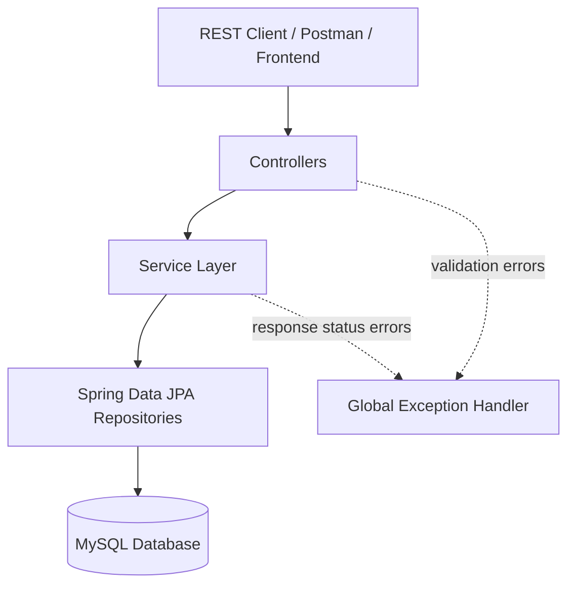

# WashWise – Laundry Management System

WashWise is a RESTful backend application for managing laundry customers, laundry services, orders, and order items. It is built with Java, Spring Boot, Spring Data JPA, Hibernate, and MySQL.

## Project overview

The application provides REST endpoints to:
- Create, retrieve, update, and delete customers.
- Maintain laundry services and their prices.
- Create and manage laundry orders.
- Add, update, retrieve, and delete order items.
- Calculate order totals from order items.
- Update order status and record the actual delivery date when an order is marked `Delivered`.
- Retrieve late orders and dashboard statistics, including paid-order revenue.

## Technology stack

| Technology | Use in this project |
|---|---|
| Java 25 | Application language (configured in `pom.xml`) |
| Spring Boot 4.1.1 | Application framework (configured in `pom.xml`) |
| Spring Web MVC | REST controllers |
| Spring Data JPA | Repository and persistence layer |
| Hibernate | ORM implementation |
| MySQL | Relational database |
| Maven Wrapper | Build and run commands |
| Jakarta Validation | Request/entity validation |

The versions above are taken from the uploaded `pom.xml`; verify your local JDK and Maven environment are compatible.

## Architecture



### Package structure

```text
src/main/java/com/ameer/laundrymanagment/
├── LaundrymanagmentApplication.java
├── controller/
│   ├── CustomerController.java
│   ├── DashBoardController.java
│   ├── LaundryOrderController.java
│   ├── LaundrySeviceController.java
│   └── OrderItemController.java
├── exception/
│   └── GlobalExceptionHandler.java
├── model/
│   ├── Customer.java
│   ├── LaundryOrder.java
│   ├── LaundryService.java
│   └── OrderItem.java
├── repository/
│   ├── CustomerRepo.java
│   ├── LaundryOrderRepo.java
│   ├── LaundryServiceRepo.java
│   └── OrderItemRepo.java
└── service/
    ├── CustomerService.java
    ├── LaundryOrderService.java
    ├── LaundryServiceServices.java
    └── OrderItemService.java
```

## Data model

The JPA entities and relationships in the source are documented in [`docs/DATABASE_DESIGN.md`](docs/DATABASE_DESIGN.md).

- A `LaundryOrder` has a many-to-one relationship to `Customer` through `cid`.
- An `OrderItem` has a many-to-one relationship to `LaundryOrder` through `oid`.
- An `OrderItem` has a many-to-one relationship to `LaundryService` through `sid`.

## API reference

The exact mappings from the controller source are listed in [`docs/API_DOCUMENTATION.md`](docs/API_DOCUMENTATION.md).

Base URL for local development:

```text
http://localhost:9542
```

All controllers currently allow cross-origin requests from `http://localhost:3000`.

## Business rules visible in the current implementation

- Order statuses accepted by the status endpoint are `Pending`, `Processing`, `Ready`, and `Delivered`.
- When an order status is changed to `Delivered`, the service sets `actualDeliveryDate` to the current date if it is not already set. For other statuses, it clears `actualDeliveryDate`.
- When an order item is created, its price is calculated as `laundryService.price × quantity`.
- Creating, updating, or deleting an order item triggers recalculation of its order's `totalAmount`.
- Dashboard revenue sums `totalAmount` for orders whose `paymentStatus` is exactly `Paid`.
- Late orders are orders whose expected delivery date is before today and whose status is not `Delivered`.

## Prerequisites

- JDK compatible with Java 25.
- MySQL Server.
- Git (if cloning the repository).

## Database setup

Create the database in MySQL:

```sql
CREATE DATABASE ameer;
```

The committed `src/main/resources/application.properties` uses environment-variable placeholders:

```properties
spring.datasource.url=${DB_URL:jdbc:mysql://localhost:3306/ameer}
spring.datasource.username=${DB_USERNAME:root}
spring.datasource.password=${DB_PASSWORD}
```

### Windows Command Prompt

Set the values in the same terminal session from which you start the application:

```cmd
set DB_URL=jdbc:mysql://localhost:3306/ameer
set DB_USERNAME=root
set DB_PASSWORD=YOUR_LOCAL_MYSQL_PASSWORD
```

Replace the placeholder with your own local password. Never commit or share the real value.

If you run from Spring Tool Suite / Eclipse, add these variables in **Run Configurations → Environment** for `LaundrymanagmentApplication`.

> `.env.example` is only a reference template. Spring Boot does not automatically read `.env` files unless an additional dotenv integration is configured.

## Run locally on Windows

Clone the repository:

```bash
git clone https://github.com/Ameer563/WashWise-Laundry-Managment-System.git
cd WashWise-Laundry-Managment-System
```

Set the environment variables as described above, then run:

```cmd
mvnw.cmd spring-boot:run
```

The application listens on port `9542` as configured in `application.properties`.

Run tests:

```cmd
mvnw.cmd test
```

The uploaded source contains a Spring Boot test class; run the command above to verify the current test result in your own environment.

## Error handling and validation

`GlobalExceptionHandler` handles:
- `MethodArgumentNotValidException` and returns a 400 response with status, error, message, and request path.
- `ResponseStatusException` and returns the corresponding HTTP status with status, error, message, and request path.

Validation annotations in the entities include required customer name and phone number, maximum address length, positive service price and order-item quantity, required order date/status/payment status, and an allowed order-status pattern.

## Screenshots

Add genuine screenshots from your own running application or Postman collection to `docs/screenshots/`, then link them here. Do not add screenshots containing credentials, tokens, or real customer personal data.

Suggested screenshots:
1. Customer CRUD request/response.
2. Laundry service CRUD request/response.
3. Create order and add order items.
4. Dashboard response.
5. Late orders response.

## Current limitations / future improvements

These are potential improvements based on the current source; they are not claimed as implemented:
- Add authentication and authorization.
- Add DTOs to avoid exposing persistence entities directly from REST endpoints.
- Add pagination and filtering for collection endpoints.
- Add more comprehensive unit and integration tests.
- Consider `BigDecimal` instead of `Double` for monetary values.
- Add database migrations (for example, Flyway or Liquibase).
- Review update and not-found behavior consistently across all services.
- Add API documentation through OpenAPI/Swagger.
- Add deployment configuration and environment-specific profiles.

## Security

- Never commit real passwords, tokens, or API keys.
- Keep database credentials in environment variables or private IDE run configurations.
- Review staged changes before committing with `git diff --cached`.
- If a secret was ever pushed to a public repository, rotate it; removing it from the latest version does not remove it from Git history.

## Author

**Ameer Gurajala**  
GitHub: [@Ameer563](https://github.com/Ameer563)
