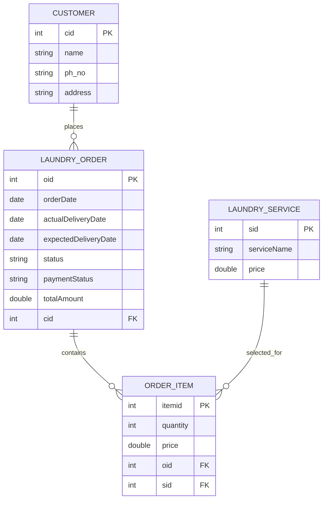

# WashWise Database Design

This document is based on the JPA entity annotations in the uploaded source.

## Entities and columns

### `customer`

| Field | Notes |
|---|---|
| `cid` | Primary key; generated with `IDENTITY` |
| `name` | Required (`@NotBlank`) |
| `ph_no` | Required (`@NotBlank`) |
| `address` | Maximum 250 characters |

Table name: `customer`.

### `laundry_service`

| Field | Notes |
|---|---|
| `sid` | Primary key; generated with `IDENTITY` |
| `serviceName` | Required (`@NotBlank`) |
| `price` | Must be positive (`@Positive`) |

Table name: `laundry_service`.

### `laundry_order`

| Field | Notes |
|---|---|
| `oid` | Primary key; generated with `IDENTITY` |
| `orderDate` | Required |
| `actualDeliveryDate` | Optional date |
| `expectedDeliveryDate` | Optional date |
| `status` | Required; entity pattern allows Pending, Processing, Ready, Delivered |
| `paymentStatus` | Required |
| `totalAmount` | Order total |
| `customer` | Many-to-one relationship via join column `cid` |

Table name: `laundry_order`.

### `order_item`

| Field | Notes |
|---|---|
| `itemid` | Primary key; generated with `IDENTITY` |
| `quantity` | Must be positive |
| `price` | Calculated by service as service price × quantity |
| `lo` | Many-to-one relationship to `LaundryOrder`, join column `oid` |
| `laundryService` | Many-to-one relationship to `LaundryService`, join column `sid` |

Table name: `order_item`.

## Entity relationship diagram



The diagram shows the relationships explicitly declared in the entity classes. The `||--o{` notation expresses the intended many-to-one ownership from the child entity side; confirm actual database constraints in MySQL if you need a schema-level diagram.

## Order total calculation

When an order item is created, the service calculates:

```text
order item price = laundry service price × quantity
```

After an order item is created, updated, or deleted, `OrderItemService.updateOrderTotal` sums the item prices for that order and updates `LaundryOrder.totalAmount`.

The `LaundryOrderService.calculationTotal` method also recalculates the total by summing item prices associated with the order.

## Dashboard revenue

`LaundryOrderRepo.getTotalRevenue()` sums `LaundryOrder.totalAmount` for orders whose `paymentStatus` is exactly `Paid`.

## Database initialization

The application properties configure:

```properties
spring.jpa.hibernate.ddl-auto=update
```

Hibernate can update the schema based on entity mappings when the application starts. For production systems, consider using versioned migrations rather than relying on automatic schema updates.
